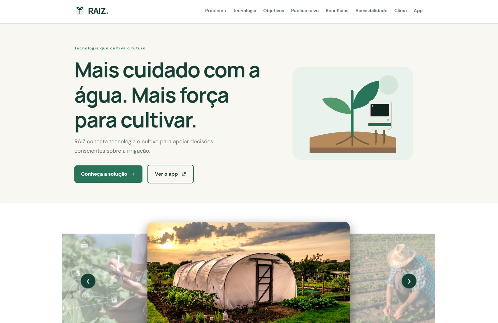

<p align="center">
  
</p>

<h1 align="center">RAIZ</h1>

<p align="center"><em>Mais cuidado com a água. Mais força para cultivar.</em></p>

Landing page do **Projeto RAIZ**, desenvolvida pelo grupo **SONDER** para a Global Solution 2026 da FIAP (tema CitizenTech).



## Sobre o projeto

O RAIZ é um sensor de umidade do solo para pequenos produtores de hortaliça folhosa do cinturão verde da Região Metropolitana de São Paulo. Um app projeta em quantas horas será preciso irrigar, o que ajuda a economizar água e a proteger a colheita.

O projeto se conecta às ODS **2** (Fome zero), **9** (Indústria, inovação e infraestrutura), **10** (Redução das desigualdades) e **13** (Ação contra a mudança do clima).

## Seções da página

- **Galeria**: carrossel com fotos de cultivo
- **Problema**: o desafio de irrigar sem desperdício
- **Tecnologia**: como o sensor e o app funcionam
- **Objetivos**: o que o RAIZ quer alcançar
- **Público-alvo**: quem o projeto atende
- **Benefícios**: o ganho para o produtor
- **Acessibilidade**: quatro caminhos para a mesma informação (interface facilitada, voz, mascote e suporte humano)
- **Feedback**: formulário para o visitante deixar sua opinião

## MVP simulado

Além da landing page, o RAIZ tem um **protótipo navegável do aplicativo**, publicado em um projeto separado na Vercel. Ele mostra como o produtor usaria o RAIZ no dia a dia.

**Site:** https://raiz-sonder.vercel.app  
**App:** https://raiz-sonder-app.vercel.app


<p align="center">
  
</p>

> **Protótipo simulado gerado com inteligência artificial.** Os dados são fictícios e não vêm de um sensor real. O aviso aparece em todas as telas.

| Tela | O que mostra |
| --- | --- |
| **Início** | Umidade atual em número grande, o estado em uma palavra, o mascote e em quantas horas irrigar |
| **Canteiros** | Alface, rúcula e couve, cada um com número, estado, ícone e mascote |
| **Histórico** | Resumo simples das últimas 24 horas e, se a pessoa quiser, o gráfico técnico |
| **Ajuda** | Contato com a cooperativa e a Casa da Agricultura, e explicação do mascote |

**Os quatro caminhos da acessibilidade, ao mesmo tempo:**

- **Interface facilitada:** número grande, uma palavra só, ícone antes do texto e alvos de toque de 44 px.
- **Dados por voz:** o botão "Ouvir" lê a leitura e a recomendação em português simples.
- **Mascote interativo:** as cinco expressões mudam conforme o estado do solo.
- **Suporte por equipe:** atendimento humano sempre a um toque.

<p align="center">
  
  
  
  
  
  <br>
  <sub>Encharcado · Solo ok · Atenção · Irrigar agora · Sensor falhou</sub>
</p>

O protótipo segue a mesma identidade visual da landing page. Um botão "Simular nova leitura" sorteia um dos cinco estados para demonstrar o funcionamento.

## Tecnologias

- **HTML5**: estrutura semântica (`header`, `main`, `section`, `footer`)
- **CSS3**: variáveis, Flexbox, `clamp()`, `position: sticky` e layout responsivo com `@media`
- **JavaScript**: validação do formulário de feedback, carrossel de imagens e, no app, troca de telas e simulação das leituras
- **Web Speech API**: leitura por voz no app (`speechSynthesis`, em português)
- **Vercel**: hospedagem do site e do app em dois projetos separados

## Estrutura

```
raiz/
├── index.html       # página principal
├── css/
│   ├── styles.css   # estilos da página
│   └── carousel.css # estilos do carrossel
├── js/
│   ├── script.js    # função enviarFeedback()
│   └── carousel.js  # carrossel de imagens
├── app/
│   ├── index.html   # MVP simulado do aplicativo
│   └── favicon.svg  # ícone do app (mascote Solo ok)
├── img/             # imagens, logo e mascotes
│   └── mascote/     # as cinco expressões do mascote
├── docs/            # prints do site e do app usados no README
├── ia.md            # declaração de uso de IA
└── INTEGRANTES.md
```

## Como acessar

O projeto está publicado:

- **Site:** https://raiz-sonder.vercel.app
- **App (MVP simulado):** https://raiz-sonder-app.vercel.app

Para rodar no computador:

1. Clone o repositório:
   ```bash
   git clone https://github.com/SonderSK/raiz.git
   ```
2. Abra o arquivo `index.html` no navegador. O app fica em `app/index.html`.

Não é preciso instalar nada.

## Integrantes

| Nome | RM |
| --- | --- |
| Guilherme Andrade Dos Santos Trevisan | 576676 |
| João Victor Matos de Almeida | 574928 |
| David Manoel Barros Pereira | 576915 |
| Lucas dos Santos Gomes | 576912 |
| Thales Bernardino Seixas | 574617 |

## Uso de IA

O grupo usou IA como ferramenta de estudo, e o MVP simulado foi gerado com IA a partir das nossas instruções. Os detalhes estão em [ia.md](ia.md).

---

**Grupo SONDER** · Global Solution 2026 · FIAP
